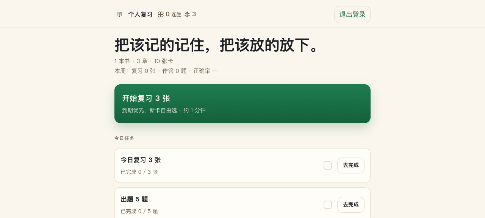
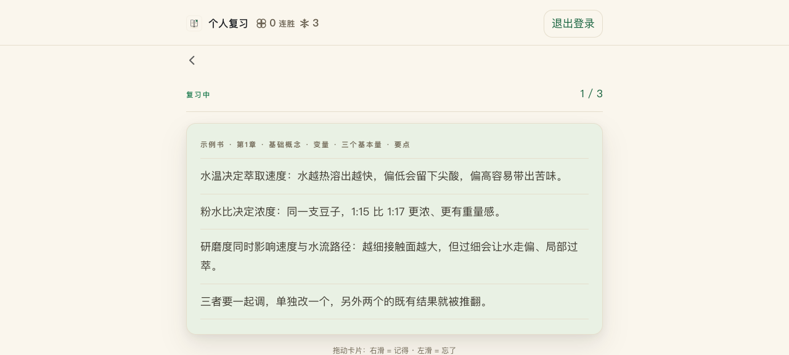

# pagetrace · 学而时习之

[](https://github.com/xicheng00-create/pagetrace/actions/workflows/ci.yml)

把一本书变成可复习的卡片，每张卡能翻回原书页码

## 界面




截图仅含合成卡。JSONL 演示卡保留书、章、页码，没有对应 PDF；上传 PDF 的卡可以打开原文，不为演示卡提供虚假的原文链接。

## 安装（Python 3.11+）

```sh
git clone https://github.com/xicheng00-create/pagetrace.git && cd pagetrace
python3 -m venv .venv && .venv/bin/pip install -r requirements.txt
.venv/bin/python backend/app.py
```

打开 http://127.0.0.1:5004 。默认仅监听本机；对外开放前请设置随机 `APP_SECRET` / `JWT_SECRET` 并自行配置 HTTPS。运行数据默认都落在项目内的 `data-local/`（卡片库、上传件、用量日志），删掉这个目录就等于重置。**PDF 出卡需要两个条件**：配置模型环境变量（`LLM_API_KEY` 等）**并**设 `UPLOAD_WORKER_ENABLED=1`（默认 `0`，即关闭）；只配置密钥而不开这个开关，上传行会显示「上传处理尚未启用」。浏览与复习演示卡不需要 API 密钥。

## 模型（LLM）配置

只有两处会调用模型：**上传 PDF → 生成卡片**、**测验出题**。浏览、复习 demo 卡、多用户与邀请码注册都不需要密钥；测验在没有密钥时会退化为机械派生题（仍能作答，质量下降并记 warning）。仓库带一份示例配置，复制后按注释填自己的：

```sh
cp .env.example .env    # 填 LLM_API_KEY / LLM_BASE_URL / LLM_MODEL
```

- 任何 **OpenAI 兼容端点**都能接（请求 `{base_url}/chat/completions`，用 `Authorization` 请求头带密钥）：厂商官方 API、自建 LiteLLM / One-API 网关、Ollama、vLLM 等
- `LLM_PROVIDER` 三选一：`official` 官方直连（未设 `LLM_BASE_URL` 时取 `DEEPSEEK_BASE_URL`）／`proxy` 自建网关（默认 `http://localhost:4000`）／`local` 本机模型（默认 `http://localhost:8080/v1`）
- **别忘 `UPLOAD_WORKER_ENABLED=1`**：只填密钥不开这个开关，PDF 只会排队、不会出卡
- 对外提供服务前把 `APP_SECRET` / `JWT_SECRET` 改成随机值

## 首次建账号与认领

空库可在登录页「创建账号」建立首个账号。迁移旧库前请备份；空库使用迁移入口时，先运行一次应用建表，再停止自己的开发实例：

```sh
.venv/bin/python scripts/migrate_s2_multiuser.py data-local/review.sqlite3
```

迁移脚本会建一个占位账号，用户名默认 `owner`，可在执行前用 `S2_OWNER_USERNAME` 改。首次登录时用该账号和**你自己设的 ≥8 位密码**完成认领；占位哈希不能登录，**没有可用默认密码**。测试夹具里的密码不是部署凭据。

## 加载演示卡

```sh
.venv/bin/python backend/scripts/ingest_kb.py --file demo/cards.jsonl --db data-local/review.sqlite3
```

入库默认使用 `owner`；迁移时若改了账号，请为入库同样设置 `S2_OWNER_USERNAME`。10 张卡是手冲主题合成内容，不含真实书目或阅读记录。先入库，再登录 `owner` 认领即可体验；如果先创建了其他账号，该账号不会自动获得其他账号的卡片。

## 五层钻取


卡片显示出处（书 / 章 / 页码），首页支持图书范围、今日复习与测验任务，学习进度按账号隔离。

## 开发

```sh
make lint test
```

测试使用临时库；可选跨项目公式比对在参考项目缺席时跳过。公开版不包含私人部署脚本、服务管理模板、阅读审计或生产库。MIT 许可，版权作者为占位 `Review App Contributors`。

## 邀請他人

建立第一個帳號後，owner 從首頁「邀請碼」生成一次性碼（24 小時有效），交給受邀者。對方在登入面板切換「用邀請碼註冊」，自行設定帳號與 ≥8 位密碼。member 不能生成邀請碼，個人書與進度互相隔離。
